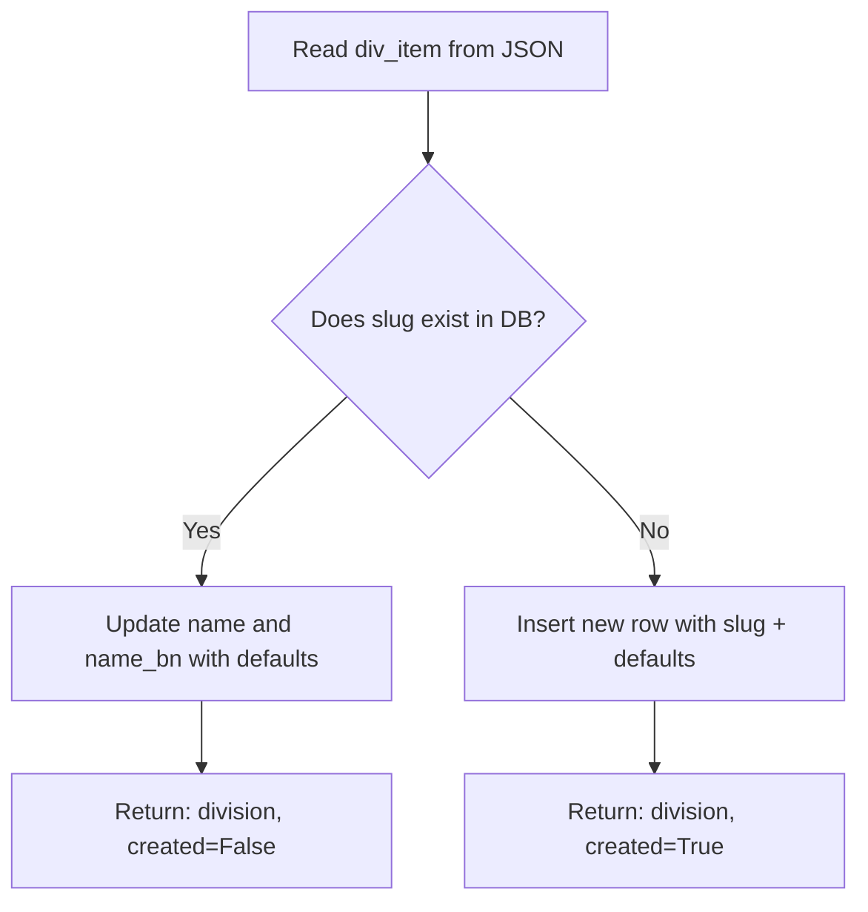

# Step 6 Explained: Locations Architecture & Idempotent Seeding

This guide explains all foundational concepts implemented in **Step 6** of the Turf Management platform. It is written specifically for Django and Django REST Framework (DRF) beginners.

---

## Table of Contents
1. [What a ForeignKey Is, and What `related_name` Does](#1-what-a-foreignkey-is-and-what-related_name-does)
2. [Why Division -> District Is a Dependent Relationship (Powering Dependent Dropdowns)](#2-why-division---district-is-a-dependent-relationship-powering-dependent-dropdowns)
3. [Unique Constraint vs. `unique=True` (Why `(division, name)` Is Unique Together)](#3-unique-constraint-vs-uniquetrue-why-division-name-is-unique-together)
4. [What a Slug Is and Why We Use It](#4-what-a-slug-is-and-why-we-use-it)
5. [What a Management Command Is and Why We Seed Programmatically](#5-what-a-management-command-is-and-why-we-seed-programmatically)
6. [What "Idempotent" Means and How `update_or_create` Works](#6-what-idempotent-means-and-how-update_or_create-works)
7. [Line-by-Line Walkthrough of `models.py` and `seed_locations.py`](#7-line-by-line-walkthrough-of-models-py-and-seed_locations-py)
8. [Database Verification & Verification Commands](#8-database-verification--verification-commands)

---

## 1. What a ForeignKey Is, and What `related_name` Does

In relational databases (like PostgreSQL), data is organized into tables. When two entities are connected in a **one-to-many** hierarchy—such as one Division containing multiple Districts—we use a **Foreign Key**.

### What a ForeignKey Does
In our `District` model:
```python
division = models.ForeignKey(
    Division,
    on_delete=models.CASCADE,
    related_name="districts",
    help_text="Division to which this district belongs",
)
```
- A ForeignKey tells PostgreSQL to add a column named `division_id` inside the `locations_district` table.
- This `division_id` stores the primary key (`id`) of the matching row in the `locations_division` table.
- **Forward lookup:** If you have a `District` object, you can access its parent division directly:
  ```python
  gazipur = District.objects.get(name="Gazipur")
  print(gazipur.division.name)  # Output: "Dhaka"
  ```
- **`on_delete=models.CASCADE`:** If a division were ever deleted from the database, all districts belonging to that division would automatically be deleted to prevent orphaned records.

### What `related_name="districts"` Does (Reverse Relation)
What if you have a `Division` object and want to retrieve **all** of its child districts?

By default, Django creates a reverse relationship named `<modelname>_set` (e.g., `division.district_set.all()`). While this works, `district_set` is generic and awkward to read.

By setting `related_name="districts"`, we tell Django: *"When accessing districts from a division instance, let us call them `.districts`."*

```python
dhaka_division = Division.objects.get(name="Dhaka")

# Natural, readable English syntax:
dhaka_districts = dhaka_division.districts.all()
print(dhaka_districts.count())  # Output: 13
```

This makes your business logic clean, intuitive, and easy to maintain.

---

## 2. Why Division -> District Is a Dependent Relationship (Powering Dependent Dropdowns)

In Bangladesh, administrative geography follows a strict hierarchy:
$$\text{Division (8)} \longrightarrow \text{District (64)} \longrightarrow \text{Thana/Upazila}$$

In our Turf Management platform, this relationship is vital for both owners and customers.

### How It Powers the Frontend "Dependent Dropdown"
When a customer searches for a turf, or when an owner registers their facility:
1. **Dropdown 1 (Division):** The frontend displays the 8 divisions (Dhaka, Chattogram, Sylhet, etc.).
2. The user selects **"Dhaka"**.
3. **Frontend API Call:** The frontend immediately sends a request to the backend:
   ```http
   GET /api/v1/locations/districts/?division=dhaka
   ```
4. **Backend Query:** The backend uses the ForeignKey relationship:
   ```python
   District.objects.filter(division__slug="dhaka")
   ```
5. **Dropdown 2 (District):** The district dropdown activates and dynamically displays **only the 13 districts in Dhaka** (Faridpur, Gazipur, Narayanganj, etc.), instead of overwhelming the user with all 64 districts in the country.

### Why Canonical Database Seeding Is Essential
If we allowed users to type their location into free-form text boxes, one user might type `"Dhaka"`, another `"dhaka"`, another `"Dhk"`, and another `"Dhaka, Bangladesh"`. 

By establishing canonical `Division` and `District` tables seeded in the database:
- Turf owners select from the exact same list.
- Customers search using the exact same list.
- There are no mismatches, misspellings, or missing search results.

---

## 3. Unique Constraint vs. `unique=True` (Why `(division, name)` Is Unique Together)

### Single-Field Uniqueness (`unique=True`)
When a single column must be unique across the entire table, we use `unique=True`.
- On `Division.name`: No two divisions in Bangladesh can share the same name (e.g., there can only be one "Dhaka").
- On `Division.slug`: No two divisions can have the slug `"dhaka"`.

### Composite Uniqueness (`unique_together`)
In `District`, we configured:
```python
class Meta:
    unique_together = ("division", "name")
```

What does this mean?
- It means the **combination** of `division` and `name` must be unique in the database.
- PostgreSQL creates a composite unique B-tree index on `(division_id, name)`.
- You cannot create two districts named `"Gazipur"` inside division `"Dhaka"`.
- If another division conceptually had an area with the same name, the database would allow it because the `division_id` would differ. Most importantly, it guarantees that no division can ever contain duplicate entries for the same district.

> **Django Tip:** In modern Django, you can also write this as `models.UniqueConstraint(fields=["division", "name"], name="unique_division_district")` inside `Meta.constraints`. Both instruct PostgreSQL to enforce database-level uniqueness across multiple columns simultaneously.

---

## 4. What a Slug Is and Why We Use It

A **slug** is a short, URL-friendly label consisting only of lowercase alphanumeric characters, numbers, and hyphens (no spaces, no special characters, and no accented letters).

### Example:
- Full Name: `Cox's Bazar`
- Slug: `coxs-bazar`

### Why Do We Use Slugs?
1. **Clean, Human-Friendly URLs:**
   - Without slug: `https://turfbooking.bd/api/v1/locations/districts/?division=3`
   - With slug: `https://turfbooking.bd/api/v1/locations/districts/?division=chattogram`
   The slug makes the URL instantly understandable to developers and users.

2. **SEO & Bookmark Stability:**
   Search engines prioritize clean keywords in URLs (`/turfs/dhaka/gazipur/`) over raw database primary keys (`/turfs/1/14/`).

3. **Security (Hiding Database IDs):**
   Using slugs avoids exposing sequential primary key IDs to the public, preventing malicious users from scraping data by simply incrementing an integer ID.

---

## 5. What a Management Command Is and Why We Seed Programmatically

### What Is a Management Command?
Django provides built-in commands via `python manage.py`, such as `migrate`, `createsuperuser`, and `runserver`.

Django allows developers to write **custom management commands** by placing Python files inside an app's `management/commands/` directory. Any class named `Command` inheriting from `django.core.management.base.BaseCommand` becomes an executable terminal command:
```bash
python manage.py seed_locations
```

### Why Seed Programmatically Instead of Manual Entry?
Bangladesh has 8 divisions and 64 districts (72 total records).
1. **Human Error:** Entering 72 records manually in the Django Admin takes 30+ minutes and inevitably leads to typos, missing Bengali translations, or misspelled slugs.
2. **Instant Developer Setup:** When a new teammate clones this repo or when spinning up a Docker container, they can run `python manage.py seed_locations` and have a fully populated, production-ready location dataset in under 1 second.
3. **Single Source of Truth:** The data lives in a version-controlled file ([bd_locations.json](file:///f:/Trial%20Projects/turf-management/backend/apps/locations/data/bd_locations.json)), committed to Git. Any fixes or additions are shared across development, staging, and production environments.

---

## 6. What "Idempotent" Means and How `update_or_create` Works

### What Does "Idempotent" Mean?
An operation is **idempotent** if running it once produces a result, and running it multiple times produces the exact same result without causing errors or unexpected changes.

$$\text{Operation}(x) = \text{Operation}(\text{Operation}(x))$$

### The Danger of Naive `.create()`
If our command simply used `District.objects.create(...)`:
- **Run 1:** 64 districts created.
- **Run 2:** **CRASH!** `IntegrityError: duplicate key value violates unique constraint "locations_district_division_id_name_key"`.
- If uniqueness was not enforced at the database level, Run 2 would create 64 duplicates, leaving 128 districts!

### How `update_or_create` Solves This
Django's `update_or_create` performs an atomic lookup and update/insert:
```python
division, div_created = Division.objects.update_or_create(
    slug=div_item["slug"],  # The unique lookup condition
    defaults={              # What to set or update
        "name": div_item["name"],
        "name_bn": div_item.get("name_bn", ""),
    },
)
```

### Execution Flow:


- **First Run:** Record does not exist $\rightarrow$ creates it (`div_created = True`). Total in DB: 8 divisions, 64 districts.
- **Second Run:** Record already exists $\rightarrow$ updates fields in `defaults` if changed (`div_created = False`). Total in DB remains strictly 8 divisions and 64 districts.
- Zero crashes, zero duplicate rows, 100% safe to include in automated deployment scripts.

---

## 7. Line-by-Line Walkthrough of `models.py` and `seed_locations.py`

### 7.1. Walkthrough of `apps/locations/models.py`

```python
from django.db import models
```
- Imports Django's Object-Relational Mapper (ORM) module.

```python
class Division(models.Model):
    name = models.CharField(
        max_length=50,
        unique=True,
        help_text="English name of division, e.g. Dhaka",
    )
```
- Defines the `Division` model representing the 8 top-level administrative regions.
- `name`: English name stored as a varchar (up to 50 chars), indexed with a unique constraint.

```python
    name_bn = models.CharField(
        max_length=50,
        blank=True,
        help_text="Bengali name of division, e.g. ঢাকা",
    )
```
- `name_bn`: Optional Bengali script translation (e.g., "ঢাকা"). `blank=True` allows forms/serializers to accept it empty if needed.

```python
    slug = models.SlugField(
        max_length=50,
        unique=True,
        help_text="URL-friendly identifier, e.g. dhaka",
    )
```
- `slug`: URL-friendly identifier used in REST API endpoints and web routes. Guaranteed unique across all divisions.

```python
    class Meta:
        ordering = ("name",)
        verbose_name = "Division"
        verbose_name_plural = "Divisions"

    def __str__(self) -> str:
        return self.name
```
- `Meta.ordering`: Default ordering when querying `Division.objects.all()`. Alphabetical order by `name`. (Using a tuple `("name",)` prevents mutable attribute linter warnings).
- `__str__`: Returns the human-readable English name when printed in Django Admin or debug logs.

```python
class District(models.Model):
    division = models.ForeignKey(
        Division,
        on_delete=models.CASCADE,
        related_name="districts",
        help_text="Division to which this district belongs",
    )
```
- Defines the child `District` model.
- `ForeignKey`: Points to parent `Division`.
- `on_delete=models.CASCADE`: If a division is deleted, its districts are deleted too.
- `related_name="districts"`: Enables reverse query `division.districts.all()`.

```python
    name = models.CharField(
        max_length=50,
        help_text="English name of district, e.g. Gazipur",
    )
    name_bn = models.CharField(
        max_length=50,
        blank=True,
        help_text="Bengali name of district, e.g. গাজীপুর",
    )
    slug = models.SlugField(
        max_length=50,
        help_text="URL-friendly identifier, e.g. gazipur",
    )
```
- Defines the district's English name, Bengali name, and URL slug.

```python
    class Meta:
        ordering = ("name",)
        verbose_name = "District"
        verbose_name_plural = "Districts"
        unique_together = ("division", "name")

    def __str__(self) -> str:
        return f"{self.name} ({self.division.name})"
```
- `unique_together = ("division", "name")`: Enforces that no division can have duplicate district names.
- `__str__`: Displays `Gazipur (Dhaka)`, providing immediate geographical context when inspecting items.

---

### 7.2. Walkthrough of `apps/locations/management/commands/seed_locations.py`

```python
import json
from pathlib import Path

from django.core.management.base import BaseCommand, CommandError
from django.db import transaction

from apps.locations.models import District, Division
```
- `json`: Standard Python library to parse JSON data.
- `pathlib.Path`: Object-oriented filesystem path manipulation.
- `BaseCommand`, `CommandError`: Django's foundation classes for writing command-line tools and reporting errors.
- `transaction`: Django database transaction controller.
- `District`, `Division`: Our models to insert into.

```python
class Command(BaseCommand):
    help = "Seed database with all 8 Divisions and 64 Districts of Bangladesh from bd_locations.json (Idempotent)."
```
- Class must be named `Command` and inherit from `BaseCommand`.
- `help`: Text shown when running `python manage.py seed_locations --help`.

```python
    def handle(self, *args, **options):
        json_path = (
            Path(__file__).resolve().parent.parent.parent
            / "data"
            / "bd_locations.json"
        )
```
- `handle()` is the entry point called when the command runs.
- Computes the dynamic path to `backend/apps/locations/data/bd_locations.json` regardless of where in the filesystem the user triggers the terminal command from.

```python
        if not json_path.exists():
            raise CommandError(f"Locations data file not found at: {json_path}")

        self.stdout.write(
            self.style.NOTICE(f"Reading locations data from: {json_path}")
        )

        try:
            with open(json_path, "r", encoding="utf-8") as f:
                divisions_data = json.load(f)
        except (OSError, json.JSONDecodeError) as e:
            raise CommandError(f"Failed to read or parse JSON file: {e}") from e
```
- Verifies the file exists.
- Opens the file with `utf-8` encoding so Bengali characters (`বাংলা`) are parsed accurately without Unicode decoding corruption.

```python
        divisions_created = 0
        divisions_updated = 0
        districts_created = 0
        districts_updated = 0
```
- Initializes counters to track whether objects were created or updated.

```python
        with transaction.atomic():
```
- `transaction.atomic()` wraps all database write operations inside a single PostgreSQL transaction block (`BEGIN ... COMMIT`).
- If any district fails to insert, the entire operation rolls back (`ROLLBACK`), ensuring the database is never left in a broken, half-seeded state.

```python
            for div_item in divisions_data:
                division, div_created = Division.objects.update_or_create(
                    slug=div_item["slug"],
                    defaults={
                        "name": div_item["name"],
                        "name_bn": div_item.get("name_bn", ""),
                    },
                )

                if div_created:
                    divisions_created += 1
                else:
                    divisions_updated += 1
```
- Iterates over each division from the JSON file.
- Checks if a division with `slug=div_item["slug"]` exists. If not, creates it; if yes, updates `name` and `name_bn`.

```python
                for dist_item in div_item.get("districts", []):
                    _district, dist_created = District.objects.update_or_create(
                        division=division,
                        name=dist_item["name"],
                        defaults={
                            "name_bn": dist_item.get("name_bn", ""),
                            "slug": dist_item["slug"],
                        },
                    )

                    if dist_created:
                        districts_created += 1
                    else:
                        districts_updated += 1
```
- Loops through all child districts under this division.
- Looks up by `division` (the parent foreign key) and `name`.
- Updates `name_bn` and `slug` if existing, or creates a new row if absent.

```python
        total_divisions = Division.objects.count()
        total_districts = District.objects.count()

        self.stdout.write(
            self.style.SUCCESS(
                f"Locations seed complete:\n"
                f"  - Divisions: {divisions_created} created, {divisions_updated} updated (Total in DB: {total_divisions})\n"
                f"  - Districts: {districts_created} created, {districts_updated} updated (Total in DB: {total_districts})"
            )
        )
```
- Prints an informative, green-styled summary to the console confirming exact counts.

---

## 8. Database Verification & Verification Commands

### Verification Command Executed:
```bash
python manage.py shell -c "
from apps.locations.models import Division, District
print('Divisions:', Division.objects.count())
print('Districts:', District.objects.count())
dhaka = Division.objects.get(name='Dhaka')
print('Dhaka districts:', dhaka.districts.count())
"
```

### Verified Output:
```text
Divisions: 8
Districts: 64
Dhaka districts: 13
```

All 8 divisions and 64 districts are successfully registered in the database, relations are functioning properly, and the seeding script is completely idempotent.
